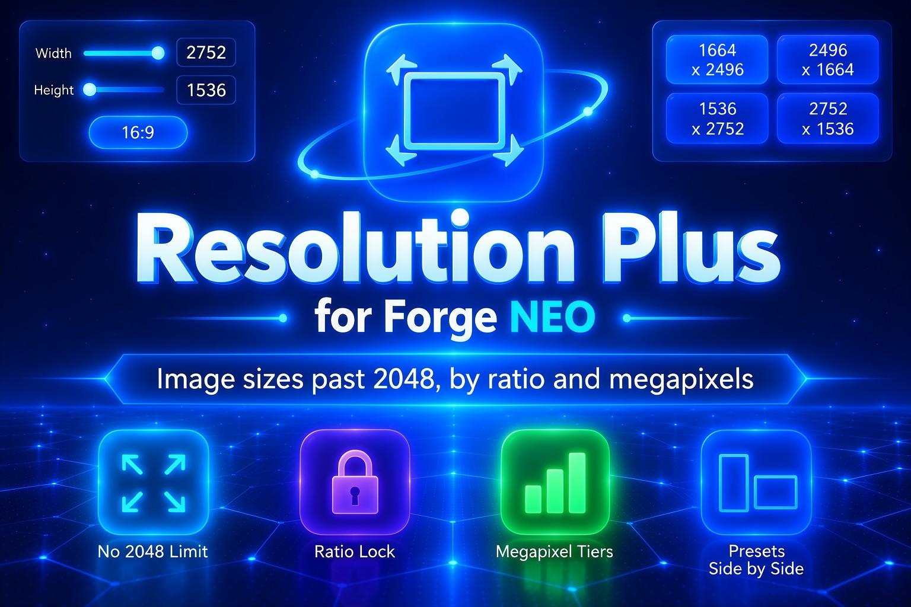
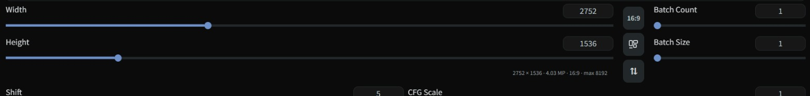
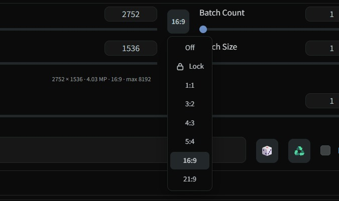
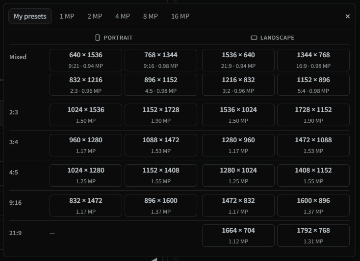
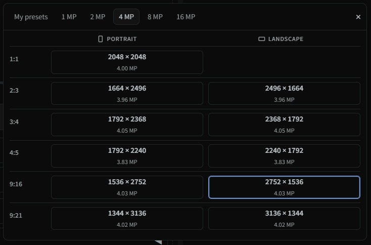

<p align="center">
  
</p>

# 📐 Resolution Plus for Forge Neo

<div align="center">

[](https://github.com/Haoming02/sd-webui-forge-classic/tree/neo)
[](https://gradio.app/)
[](https://github.com/eduardoabreu81/sd-resolution-plus-neo)
[](LICENSE)

> **Extension for [Stable Diffusion WebUI Forge - Neo](https://github.com/Haoming02/sd-webui-forge-classic/tree/neo)**

</div>

Models like **MiniMax H3 Image** generate natively far above 2048 x 2048, but the Width / Height sliders still stop there. Resolution Plus **lifts that ceiling without editing `ui-config.json`**, and picks sizes the way they now make sense: an **aspect ratio** and a **megapixel tier** - 1, 2, 4, 8, 16 MP - with your own presets next to them, portrait on the left and landscape on the right.

<p align="center"></p>

> [!Important]
> Nothing of Forge Neo is changed and generation is never touched: the extension sets the sliders' maximum when the UI is built and fills Width / Height for you. It works side by side with [Aspect Ratio Helper (Neo)](https://github.com/abzaloff/forge-neo-aspect-ratio-helper) (see [Other ratio extensions](#-other-ratio-extensions)).

---

## 📋 Table of Contents

- [What's New](#-whats-new)
- [Features](#-features)
- [Installation](#-installation)
- [How to Use](#%EF%B8%8F-how-to-use)
- [Settings](#%EF%B8%8F-settings)
- [Other ratio extensions](#-other-ratio-extensions)
- [How the Ceiling Is Lifted](#-how-the-ceiling-is-lifted)
- [Credits](#-credits)

---

## 🆕 What's New

### v0.1.1 - Works with Aspect Ratio Helper (Neo)

- With [Aspect Ratio Helper (Neo)](https://github.com/abzaloff/forge-neo-aspect-ratio-helper) on, the **ratio lock and ⇅ are left to it**: the Ratio button steps aside, while the presets, the megapixel pages, the size line and the slider maximum stay - see [Other ratio extensions](#-other-ratio-extensions)
- The presets button sits before Aspect Ratio Helper's controls, whichever extension sets up first

### v0.1.0 - First Release

- **No 2048 ceiling** - the Width / Height sliders go up to the maximum set in Settings (8192 by default), in txt2img and img2img
- **Ratio** button - Off, Lock or a ratio from your list, in the orientation of the image on screen; the other slider follows the one you move
- **Presets** popup - your own list and one page per megapixel tier, one row per ratio with portrait and landscape side by side
- **Size line** under the sliders - width x height, megapixels, ratio and the current maximum
- Your **Aspect Ratio+ preset list** is used the first time

---

## 🎯 Features

### 📏 Sizes past 2048

- The sliders' maximum comes from **Settings** (8192 by default, up to 16384), in **txt2img** and **img2img** (*Resize to*)
- `ui-config.json` is never written: turn the extension off and the sliders are what they were
- Every size snaps to Forge's own **Resolution Step** (64 by default), the step the sliders use

### 🔒 Ratio

<p align="center"></p>

- **Off**, **Lock** (keep the proportion on screen) or a ratio from your list
- The list shows each ratio once, **in the orientation of the image on screen**: 2:3, 3:4, 9:16 while it stands; 3:2, 4:3, 16:9 while it lies
- With a ratio on, **dragging or typing one side moves the other**; when the other side would pass the maximum, it stops there and the side you moved comes back, so the ratio holds
- Choosing a ratio **keeps the current megapixels**: 2752 x 1536 (16:9, 4 MP) becomes 1664 x 2496 at 2:3
- Forge's **⇅** flips the ratio too (16:9 becomes 9:16) as soon as the sizes have actually swapped; a pasted size or a UI Preset that turns the image does the same

### 🧩 Presets

<p align="center"></p>

- **My presets** - your own list, **one row per ratio**: portrait sizes on the left, landscape on the right, squares across both
- A row can mix ratios (*Mixed* above): each size then shows its own ratio
- Picking a preset with a ratio on **keeps the lock**, now on the preset's ratio

<p align="center"></p>

- **One page per megapixel tier** (1 MP = 1024 x 1024): every ratio of your list in both orientations, at the size closest to that tier - 16:9 gives **1344 x 768** (1 MP), **1920 x 1088** (2 MP), **2752 x 1536** (4 MP), **3840 x 2176** (8 MP)
- With a ratio that is not in the list, the page starts with a **Current** row at that ratio, so changing only the megapixels is one click
- The size on screen is marked; a preset above the maximum is scaled down to fit

---

## 📦 Installation

1. In Forge Neo, open **Extensions > Install from URL**
2. Paste `https://github.com/eduardoabreu81/sd-resolution-plus-neo` and click **Install**
3. Turn **sd-aspect-ratio-plus** off in **Extensions**, if you have it (Aspect Ratio Helper (Neo) can stay on)
4. Restart Forge Neo

## 🛠️ How to Use

1. Pick a ratio with the **Ratio** button (it says *Off* until you do), or leave it Off
2. Open **Presets** and choose a size: from **My presets**, or from a megapixel page (**4 MP** for MiniMax H3 Image at 2752 x 1536, for example)
3. Fine-tune with the sliders or by typing: with a ratio on, the other side follows
4. **⇅** turns the image; the ratio turns with it

## ⚙️ Settings

**Settings > User Interface > Resolution Plus**

| Option | Default | |
| --- | --- | --- |
| Width / Height slider maximum | `8192` | `0` leaves Forge's own maximum (and `ui-config.json`'s). Needs **Reload UI** |
| Aspect ratios | `1:1, 2:3, 3:4, 4:5, 9:16, 9:21` | width:height, comma-separated; each one works in both orientations |
| Megapixel tiers | `1, 2, 4, 8, 16` | one page each; decimals work (`1.5`) |
| My presets | your Aspect Ratio+ list, if any | see below |
| With the ratio Off, the tier pages start with the current proportion | on | |
| Show the controls in img2img too | on | in *Resize to*. Needs **Reload UI** |
| With Aspect Ratio Helper (Neo) on, leave the ratio lock and ⇅ to it | on | hides the Ratio button while that extension is on |

Changes to the lists show up after **Apply settings**, also after a browser refresh.

### My presets

One group per ratio, with both orientations in it; the popup sorts each size into the portrait or landscape column:

```
> 2:3
1024 x 1536
1152 x 1728
1536 x 1024
1728 x 1152

> 21:9
1664 x 704
1792 x 768
```

`>` starts a group, `#` a comment, and each line is `width x height`.

## 🤝 Other Ratio Extensions

Ratio extensions put their controls next to Width / Height too.

- **[Aspect Ratio Helper (Neo)](https://github.com/abzaloff/forge-neo-aspect-ratio-helper)** by abzaloff, the Forge Neo fork of [thomasasfk's Aspect Ratio Helper](https://github.com/thomasasfk/sd-webui-aspect-ratio-helper) - **works alongside**. Its ratio dropdown (with 🖼️, the ratio of the img2img picture) and its ⇅ take over the ratio lock, and Resolution Plus hides its own Ratio button so two locks never pull the sliders apart; the presets, the megapixel pages, the size line and the slider maximum stay. Its scale buttons (percentages, maximum and minimum dimension) can now go past 2048 too, since it follows the sliders' maximum. To keep both Ratio controls, turn off *With Aspect Ratio Helper (Neo) on, leave the ratio lock and ⇅ to it* in Settings
- **Aspect Ratio+** (`sd-aspect-ratio-plus`, by anxety-solo, no longer on GitHub) - if you still have it installed, the first time Resolution Plus runs, **My presets** starts from its preset list, which uses the same text format; its separate *Portrait* and *Landscape* groups still work, and merging each pair into one group per ratio gives the side-by-side rows. Turn it off afterwards: it also sets the fields' maximum back to the one in `ui-config.json` (usually 2048). Forge's console warns when both are on
- **[SD Simple Dimension Preset](https://github.com/gutris1/sd-simple-dimension-preset)** by gutris1 - a preset button for width and height; not tested side by side with Resolution Plus

## 🧭 How the Ceiling Is Lifted

Forge Neo builds the sliders with a maximum of 4096 (txt2img) and 2048 (img2img). Then `ui-config.json`, a file from the A1111 days, puts back the maximum it saved the first time Forge ran - usually 2048. That is why raising the cap in Forge's code changes nothing on most installs.

Resolution Plus applies its maximum right after `ui-config.json` is read, so it wins, and it never writes that file.

## 🙏 Credits

- [Forge Neo](https://github.com/Haoming02/sd-webui-forge-classic/tree/neo) by Haoming02
- Aspect Ratio+ (`sd-aspect-ratio-plus`) by anxety-solo, for the preset list format; [Aspect Ratio Helper](https://github.com/thomasasfk/sd-webui-aspect-ratio-helper) by thomasasfk, for the ratio lock and the swap that flips the ratio; [SD Simple Dimension Preset](https://github.com/gutris1/sd-simple-dimension-preset) by gutris1, for the presets button
- The idea came from [aoleg77's post on MiniMax H3 Image in Forge Neo](https://www.reddit.com/r/StableDiffusion/comments/1xt3ovz/) and BlackSwanTW's note on `ui-config.json` there

---

<div align="center">

Made with ❤️ for the Stable Diffusion community

**[Report Bug](https://github.com/eduardoabreu81/sd-resolution-plus-neo/issues)** • **[Request Feature](https://github.com/eduardoabreu81/sd-resolution-plus-neo/issues)** • **[☕ Ko-fi](https://ko-fi.com/eduardoabreu81)**

<sub>More Forge Neo extensions at <a href="https://eduardoabreu81.github.io/">eduardoabreu81.github.io</a></sub>

</div>
